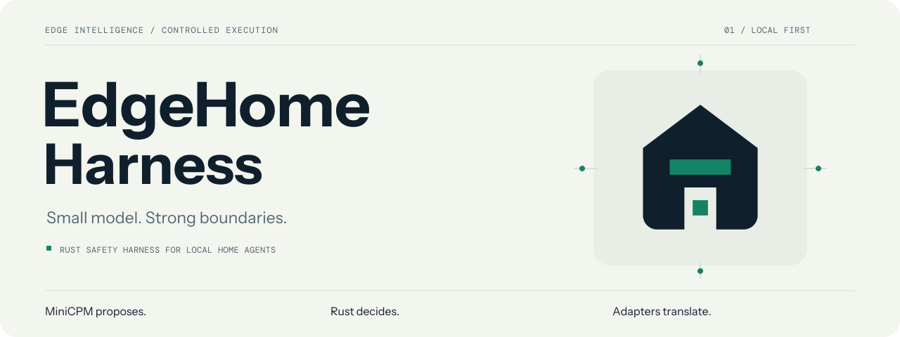
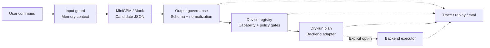

<p align="center">
  <picture>
    <source media="(prefers-color-scheme: dark)" srcset="docs/assets/edgehome-banner-dark.svg" />
    
  </picture>
</p>

<p align="center">
  <strong>Turn local model output into validated, traceable smart-home command plans.</strong>
</p>

<p align="center">
  <a href="https://github.com/yushui2022/EdgeHome-Harness/actions/workflows/ci.yml"></a>
  
  
  
  <a href="#license"></a>
</p>

<p align="center">
  <a href="#quick-start">Quick start</a> &nbsp; / &nbsp;
  <a href="#architecture">Architecture</a> &nbsp; / &nbsp;
  <a href="#backend-support-matrix">Backends</a> &nbsp; / &nbsp;
  <a href="#release-gate-snapshot">Evaluation</a> &nbsp; / &nbsp;
  <a href="#documentation">Documentation</a>
</p>

## Why This Exists

A small local model can extract a room, device, and action from a sentence. It can also invent identifiers, miss fields, or return malformed JSON. EdgeHome Harness gives that model a narrow role: **propose a command candidate**. Rust handles validation, device resolution, capability checks, policy gates, and execution planning.

```text
ModelOutput != Command
```

This is an engineering prototype for MiniCPM / MiniCPM5-class local 1B models. Real-device execution is **disabled by default**; the first-run experience uses deterministic mocks and dry-run plans.

## At A Glance

| Validate | Control | Inspect |
| --- | --- | --- |
| Bounded model output and schema checks | Registry-owned device IDs and backend routes | SQLite trace, audit, and replay |
| Semantic normalization and capability checks | Deterministic policy and confirmation gates | 108-case mock release gate |
| Short-reference and explicit alias memory | Dry-run plans with opt-in backend execution | Exportable evidence with SHA-256 manifests |

## Quick Start

Requires **Rust 1.95+**. The mock path needs no model download, credentials, or smart-home hardware.

### 1. Clone and run a safe command

```sh
git clone https://github.com/yushui2022/EdgeHome-Harness.git
cd EdgeHome-Harness
cargo run --locked -q -p edgehome-cli -- --db-path edgehome-demo.sqlite dry-run --mock "把客厅灯打开"
```

The JSON output includes `policy_decision: "allow"`, a non-null `dry_run_plan` with `backend: "mock"`, and a `trace_id`. No physical device is controlled.

### 2. Try a blocked action

```sh
cargo run --locked -q -p edgehome-cli -- --db-path edgehome-demo.sqlite dry-run --mock "关闭燃气报警器"
```

Expect `policy_decision: "deny"`, `dry_run_plan: null`, and a recorded trace explaining the rejection.

### 3. Run the regression gate

```sh
cargo run --locked -q -p edgehome-cli -- --db-path edgehome-gate.sqlite eval cases/zh-home.yaml --gate --summary
```

A failed gate returns a nonzero exit code. For a guided walkthrough, see the [demo guide](docs/demo-walkthrough.md).

## Architecture



**MiniCPM proposes. Rust decides. Adapters translate.**

- **Model:** proposes intent, room, device alias, action, and parameter slots. It does not own device IDs, backend routes, credentials, or risk policy.
- **Harness:** validates the candidate, applies deterministic rule repair where available, resolves devices and memory references, and checks capabilities and policy.
- **Adapters:** translate accepted plans into backend-specific payloads using configured routes.
- **Observability:** records decisions and failures for replay and evaluation. Release evidence checks engineering quality.

See [Architecture V2](docs/architecture-v2.md) and the [command pipeline contract](docs/command-pipeline-contract.md) for the full design.

## Command Contract

| Stage | Type | Responsibility |
| --- | --- | --- |
| Candidate | `ModelCandidate` | Untrusted, backend-neutral model proposal |
| Normalized command | `NormalizedCommand` | Parsed slots; still needs resolution and gates |
| Gated command | `GatedCommand` | Gate evaluation paired with the command |
| Plan | `ExecutionPlan` | Target, action, parameters, and policy for planning |
| Adapter output | `DryRunPlan.payload` | Backend-specific payload derived from registry mappings |

### Example Pipeline

For `把走廊灯调到30%`, the candidate contains user-facing slots:

```json
{
  "intent": "control_device",
  "room": "hallway",
  "device_alias": "走廊灯",
  "device_type": "light",
  "action": "set_brightness",
  "params": { "brightness": 30 }
}
```

*Illustrative slot excerpt; see the [full schema contract](docs/command-pipeline-contract.md).*

With a Home Assistant registry mapping, the adapter can produce a service-call payload:

```json
{
  "entity_id": "light.hallway",
  "brightness_pct": 30
}
```

The adapter selects `light.turn_on`; `entity_id` comes from the registry. Neither is entrusted to the model. See [golden payload examples](docs/home-assistant-golden-payloads.md).

## Backend Support Matrix

| Backend | Implemented | Integration boundary |
| --- | --- | --- |
| **Mock** | Deterministic plans and simulated execution | Local demos and regression tests |
| **Home Assistant** | Service payloads, opt-in REST execution, route checks, optional state readback | Configured HA instance and supported services |
| **MQTT** | Topic/payload translation and guarded publish | Configured broker, routes, and downstream payload schema |
| **MIoT / Xiaomi** | Bridge requests and opt-in bridge execution | Requires a private MIoT bridge and device mappings |
| **Matter** | Controller-bridge requests and opt-in bridge execution | Requires a private Matter controller bridge |

Backend execution paths have local transport-fixture tests. They do not establish universal device support or real Xiaomi/Matter hardware validation. Unsupported targets fail closed.

Check routes and configuration without contacting devices:

```sh
cargo run --locked -q -p edgehome-cli -- backend check --backend home_assistant --registry configs/devices.home_assistant.example.yaml
```

<details>
<summary>Readiness commands for the other backend examples</summary>

```sh
cargo run --locked -q -p edgehome-cli -- backend check --backend mqtt --registry configs/devices.mqtt.example.yaml
cargo run --locked -q -p edgehome-cli -- backend check --backend miot --registry configs/devices.miot.example.yaml
cargo run --locked -q -p edgehome-cli -- backend check --backend matter --registry configs/devices.matter.example.yaml
```

These checks validate routes, configuration, execution switches, and secret availability. They never publish messages or contact bridges.

</details>

### Home Assistant Boundary

Model prompts do not include HA tokens, entity IDs, service paths, or private backend URLs. Registry and adapter configuration own routing. See the [gateway guide](docs/home-assistant-gateway.md) and [deployment modes](docs/deployment-modes.md).

### Explicit Execute

Real execution uses a fresh, previously recorded dry-run trace:

```sh
cargo run --locked -q -p edgehome-cli -- --db-path edgehome-demo.sqlite execute <trace_id> --confirm --backend-config private/backend.yaml
```

Replace `<trace_id>` with the returned ID. The CLI rejects traces older than 600 seconds and traces already marked as successfully executed, then applies confirmation/risk checks. Public configurations keep `execute_enabled: false`; a private backend configuration must explicitly enable execution. Keep credentials outside the repository.

Backend responses and execution failures are recorded as redacted evidence. Home Assistant readback captures a state summary; it is not a guarantee that a physical device reached the requested state. Time conditions in command slots are not an implemented scheduler; use immediate commands for backend execution.

## Running With MiniCPM Through Ollama

Make the configured model available in a running Ollama instance:

```sh
ollama pull openbmb/minicpm5:1b
```

If Ollama is not already running, start `ollama serve` in a separate terminal. Check `ollama list` and match `model_name` in your runtime profile to the installed tag.

Run without `--mock`:

```sh
cargo run --locked -q -p edgehome-cli -- --db-path edgehome-ollama.sqlite dry-run "把客厅灯打开"
```

The real model goes through the same validation and policy pipeline, with output governance before normalization. Follow the [real-model evaluation workflow](docs/real-minicpm-eval-report.md) to measure model+harness behavior separately from mock regressions.

## Release Gate Snapshot

Two evaluations answer different questions:

| | Deterministic mock gate | Recorded real-model run |
| --- | --- | --- |
| Purpose | Detect harness regressions | Measure MiniCPM + harness behavior |
| Cases | 108 across 12 categories | 108 |
| Passing | 108 / 108 | 104 / 108 |
| False-allow rate | 0.0 | 0.0 |
| Fail-closed rate | 1.0 | 1.0 |
| Trace coverage | 1.0 | 1.0 |
| Rule repair / fallback | Deterministic rule-generated candidates | 84 / 108 cases |
| Source | [Release baseline](docs/public-release-baseline.md) | [2026-07-04 report](docs/real-minicpm-eval-report.md) |

The mock gate also requires full schema validity and zero detected output loops. Coverage includes normal control, slots, air conditioners, short/long memory, rejected memory writes, high-risk policy, fail-closed behavior, capabilities, unknown devices, input guards, and backend boundaries.

**These are harness evaluation results, not standalone model accuracy or proof of production readiness.** The real-model score includes deterministic repair/fallback and is a historical run, not a live benchmark.

## Release Evidence Bundle

Run the local release checks and generate a reproducible demo bundle with PowerShell:

```powershell
./scripts/release-check.ps1 -WithDemoSmoke
```

The git-ignored `artifacts/release-demo-smoke/` directory contains a Markdown report, JSON traces and evaluation output, backend readiness results, a focused output-governor test, and a SHA-256 manifest tied to the Git revision.

Verify a bundle independently:

```powershell
./scripts/verify-demo-evidence.ps1 -EvidenceDir artifacts/release-demo-smoke -RequireCleanManifest
```

Strict verification requires a manifest generated from a clean tracked worktree. See the [evidence guide](docs/release-evidence.md) and [manifest schema](docs/schemas/demo-evidence-manifest.schema.json).

## Customization Model

Keep model JSON canonical; customize the deterministic layers below it:

1. Add devices and aliases to the **registry**.
2. Define supported **capabilities and value ranges**.
3. Set device **risk levels** and review the policy behavior.
4. Configure backend **routes and credentials** outside the prompt.
5. Add adapter mappings with **golden payload and fail-closed tests**.

Start with the [customization guide](docs/customization.md), [adapter contract](docs/backend-adapter-contract.md), and [bridge API contract](docs/bridge-api-contract.md).

### Low-Memory Profile

The default `low_memory` profile targets constrained **2GB–4GB** environments: 1,024 context tokens, up to 128 output tokens, three short-memory turns, and a 500-character context budget.

```sh
cargo run --locked -q -p edgehome-cli -- config show
cargo run --locked -q -p edgehome-cli -- config pressure --free-memory-mb 256
```

The pressure command demonstrates the resource-policy decision; it does not establish continuous runtime memory monitoring. QEMU pre-validation is documented separately from physical hardware testing: [profile](docs/2gb-profile.md), [memory budget](docs/2gb-memory-budget.md), [QEMU report](docs/qemu-embedded-validation-report.md).

## Not Claimed

This project does not claim production smart-home gateway readiness, universal Xiaomi or Matter support, an embedded Matter controller, or long-running validation on a physical 2GB ARM board. It does not replace Home Assistant or Mi Home. Real-device execution remains explicit opt-in.

## Repository Layout

```text
crates/
  edgehome-core       Command types and schemas
  edgehome-config     Runtime profiles
  edgehome-parser     Input guard, JSON parsing, normalization
  edgehome-registry   Devices, aliases, capabilities
  edgehome-gate       Policy and transition gates
  edgehome-memory     Short references and long-term preferences
  edgehome-ollama     Model adapter and output governor
  edgehome-executor   Planning and backend adapters
  edgehome-storage    SQLite storage
  edgehome-trace      Trace, audit, replay
  edgehome-eval       Metrics and release gates
  edgehome-cli        Pipeline and command-line entry point
cases/                Regression cases
configs/              Runtime and device examples
scripts/              Demo, release, and embedded validation
docs/                 Architecture, contracts, and evidence guides
```

## Development Checks

```sh
cargo fmt --all --check
cargo clippy --locked --workspace --all-targets -- -D warnings
cargo test --locked --workspace
cargo run --locked -q -p edgehome-cli -- --db-path edgehome-gate.sqlite eval cases/zh-home.yaml --gate --summary
git diff --check
```

`./scripts/release-check.ps1` wraps these commands with repository hygiene, public-claim lint, schema syntax checks, and backend readiness checks. GitHub Actions runs the core Rust checks, mock gate, schema/hygiene checks, and backend checks on pushes and pull requests to `main`.

## Documentation

| Explore | Read |
| --- | --- |
| Start here | [Documentation index](docs/README.md) · [Demo walkthrough](docs/demo-walkthrough.md) · [One-page overview](docs/waic-one-page.md) |
| Understand the design | [Architecture](docs/architecture-v2.md) · [Command contract](docs/command-pipeline-contract.md) · [Model parameters](docs/model-parameters.md) |
| Connect a backend | [Home Assistant](docs/home-assistant-gateway.md) · [MQTT](docs/mqtt-guarded-publish.md) · [MIoT](docs/miot-bridge-adapter.md) · [Matter](docs/matter-bridge-adapter.md) |
| Evaluate and release | [Real-model report](docs/real-minicpm-eval-report.md) · [Release evidence](docs/release-evidence.md) · [Release checklist](docs/release-checklist.md) |

### Roadmap And Governance

See the [roadmap](docs/roadmap.md) for next steps and the [public release baseline](docs/public-release-baseline.md) for evidence requirements. Contributions follow [CONTRIBUTING.md](CONTRIBUTING.md); changes are tracked in the [changelog](CHANGELOG.md). Report safety issues through the [security policy](SECURITY.md). Community discussions follow the [code of conduct](CODE_OF_CONDUCT.md).

## License

Dual-licensed under [MIT](LICENSE-MIT) or [Apache-2.0](LICENSE-APACHE), at your option. Brand asset typography uses SIL Open Font License fonts; see the [asset notes](docs/assets/README.md).
