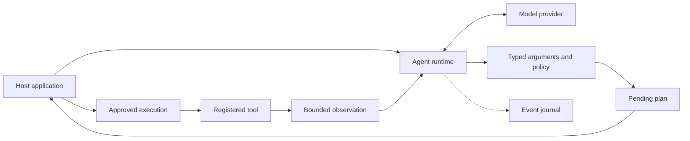

<p align="center">
  
</p>

<p align="center">
  <strong>A lightweight Rust foundation for local agents on resource-constrained devices.</strong><br />
  Your models. Your tools. Controlled execution.
</p>

<p align="center">
  <a href="https://github.com/yushui2022/EdgeHome-Harness/actions/workflows/ci.yml"></a>
  
  <a href="LICENSE"></a>
</p>

<p align="center">
  <a href="#quick-start">Quick start</a> &nbsp; · &nbsp;
  <a href="#build-on-edgehome">Build on EdgeHome</a> &nbsp; · &nbsp;
  <a href="#documentation">Docs</a>
</p>

## Overview

**EdgeHome Harness is an embeddable foundation for building small-model agents.** It connects local inference to application-defined tools through typed arguments, bounded task loops, explicit approval, and execution records.

Developers bring their model, tools, and application. The SDK manages proposals, pending plans, tool observations, and continuation. Use it to build document utilities, device assistants, local service operators, or other focused agents without changing the runtime's domain types.

The design takes inspiration from Pi's embeddable agent and tool-extension approach. This repository maintains an independent Rust implementation for constrained, short-task workflows. Smart-home control remains a separate reference application with its own device policies and evaluation suite.

**Models propose actions. The host application controls execution.**

## Core Capabilities

| Capability | Implementation |
| --- | --- |
| **Embeddable runtime** | A domain-independent `Agent`, typed tool registry, and configurable event journal |
| **Interchangeable inference** | Bounded Ollama and OpenAI-compatible clients with six engine presets |
| **Controlled execution** | Private expiring plans, host confirmation, repeated precondition checks, and one dispatch attempt per plan |
| **Resumable clarification** | Task-local questions, retained draft arguments, user-supplied fields, and application policy that can allow, ask, or deny |
| **Bounded task loops** | Per-instance model/tool budgets, context and output limits, and explicit continuation |
| **Testable integration** | A document-tool example, fault-injection tests, HTTP fixtures, and a separate smart-home reference |

The SDK uses Rust `std`. Its core has no HTTP, SQLite, or smart-home dependency; inference transport is an optional companion crate. Application-specific access control and tool implementation remain with the host.

## Quick Start

Requires **Rust 1.95+**. Create your own application with two replaceable tools:

```sh
git clone https://github.com/yushui2022/EdgeHome-Harness.git
cd EdgeHome-Harness
cargo run --locked -p edgehome-kit -- init ../my-edge-agent --name my-edge-agent
cd ../my-edge-agent
cargo run -- doctor --mock
cargo run -- run --mock --prompt "Count the sample document" --tool document.stats --allow document.stats
```

The generated project owns its tool code and references the SDK through local path dependencies. It includes a configuration file, document and sensor fixtures, task cases, and a Python client. No model, credentials, or device is needed for `--mock`.

| Command | Purpose |
| --- | --- |
| `init` | Generate an independent application without overwriting existing files |
| `doctor` | Validate configuration; `--probe` checks two system-only instructions |
| `run` | Preview a task; `--allow TOOL` authorizes execution of named tools |
| `rpc` | Host the same tools over bounded stdio for another application |
| `eval` | Check tool selection, arguments, and actual results against fixed cases |

Start with the [developer guide / 开发入口](docs/developer-kit.md). Execution returns the tool receipt by default; `--loop` enables further model turns. `--events` emits lifecycle metadata, and `--journal` creates a bounded session log. The log does not restore execution.

For an application using actual local data, follow the [read-only file agent](docs/file-agent.md). It demonstrates explicit directory access, ambiguous-path clarification, user replies over RPC, and execution-time policy checks. Model-selected arguments still require application review; these checks do not establish general intent accuracy.

<details>
<summary>Run the smaller SDK example directly inside the repository</summary>

Start with a deterministic provider and an in-memory document tool. No model download, credentials, or device is required.

### 1. Preview a tool call

```sh
git clone https://github.com/yushui2022/EdgeHome-Harness.git
cd EdgeHome-Harness
cargo run --locked -p edgehome-inference --example document_agent
```

The example proposes `document.stats` for the built-in `sample` document. Execution is disabled by default.

### 2. Complete the local task

```sh
cargo run --locked -p edgehome-inference --example document_agent -- --execute-demo
```

The host approves this example's read-only fixture, receives **84 characters and 2 lines**, and passes the observation back to the provider for a final answer. The complete integration is in [`document_agent.rs`](crates/edgehome-inference/examples/document_agent.rs).

### 3. Connect a model

Start your inference service, copy its [configuration preset](configs/inference/ollama.yaml), and replace `model` with the name actually served by that engine:

```sh
cargo run --locked -p edgehome-inference --example document_agent -- --config configs/inference/ollama.yaml --execute-demo
```

The SDK sends a structured decision schema and validates the returned candidate again. An experimental, opt-in action-first protocol supports explicit missing values and bounded validation repair. Model quality, chat templates, and schema support affect task completion; see the [reliability study](docs/model-reliability.md) and [engine guide](docs/inference-engines.md).

For tasks that need only the tool's authoritative result, add `--result-only` to stop after execution. The host can use the structured receipt directly, saving a second inference call and avoiding model-written restatement errors.

</details>

## Build On EdgeHome

Add the crates to your Cargo application through local path dependencies, then follow the [SDK integration guide / 端侧 Agent SDK](docs/edge-agent-sdk.md).

| Component | What you configure or implement |
| --- | --- |
| [`edgehome-kit`](crates/edgehome-kit/src/lib.rs) | Shared `doctor/run/rpc/eval` entry points; keep your application's tools in its own source files |
| [`edgehome-runtime`](crates/edgehome-runtime/src/lib.rs) | `AgentConfig`, instance lifetime, approval, and the host-driven task loop |
| [`edgehome-inference`](crates/edgehome-inference/src/lib.rs) | Engine, endpoint, model name, and request budgets; built-in clients handle HTTP bounds |
| [`TypedTool`](crates/edgehome-runtime/src/tool.rs) | A Rust argument type, semantic validator, and bounded execution handler |
| [`Journal`](crates/edgehome-runtime/src/journal.rs) | Optional persistent event storage; the default retains bounded metadata in memory |

Register a few narrowly scoped tools. Derive `Deserialize` and `JsonSchema` for their arguments, reject unknown fields, and validate permissions and current state in the validator. The same argument type supplies the model-facing schema and host-side deserialization.

Drive the application through `prompt` → proposal → approved `execute` → `continue_run`. Each turn returns a tool proposal, final answer, or clarification. Tools receive a time and output budget; application handlers must enforce these during their own I/O.

Resume clarification with `reply` for natural-language input or `resolve` for host-supplied fields. `Tool::preflight` and `GuardedTool` let applications request missing information or reject a proposal using their own state. Neither clarification method executes a tool or resets the instance's call budgets.

New domains do not require edits to the SDK's core types. The smart-home application can continue using its existing registry and adapters; these are not automatically imported into the generic tool registry.

Use `prompt_with_tools` to expose only the relevant tools for a task. The runtime also rejects out-of-scope calls locally. Lifecycle events, usage counters, and a cooperative cancellation token let hosts observe and stop work; blocking callbacks still require their own deadlines.

## Inference Engines

| Preset | Intended role | Validation in this repository |
| --- | --- | --- |
| [Ollama](configs/inference/ollama.yaml) | Local development and model management | HTTP contract tests and documented real-model probes |
| [llama.cpp](configs/inference/llama-cpp.yaml) | GGUF deployment on CPU/ARM and edge systems | HTTP contract tests; target-device qualification remains open |
| [LM Studio](configs/inference/lm-studio.yaml) | Desktop model loading and local development | HTTP contract tests |
| [vLLM](configs/inference/vllm.yaml) | Server-side inference for higher concurrency | HTTP contract tests |
| [SGLang](configs/inference/sglang.yaml) | Optional high-throughput server backend | HTTP contract tests |
| [OpenAI-compatible](configs/inference/openai-compatible.yaml) | Other services implementing the documented contract | Shared protocol tests; service-specific validation required |

Ollama is the default development path; llama.cpp is the priority for edge deployment validation. These are engineering priorities, not a market-share ranking. You select one inference service for a deployment; the SDK does not require these engines to run together.

Presets share two wire protocols: Ollama `/api/chat` and OpenAI-compatible `/chat/completions`. Both request schema-constrained JSON without relying on native tool-calling templates. The client enforces request deadlines and response-byte limits, including chunked responses, and reports truncation or refusal explicitly. See [protocol details and official sources](docs/inference-engines.md).

## Architecture



The host owns identity, approval, credentials, and domain policy. The runtime retains one private pending plan; previews cannot change it. A new prompt, cancellation, or expiry invalidates the old plan. Validation runs again before dispatch.

A plan permits at most one dispatch attempt within its instance. A failed handler, late response, or oversized tool result yields `OutcomeUnknown` and stops continuation. The runtime does not retry side effects. A start-event failure blocks dispatch; a completion-event failure is reported separately and cannot make the consumed plan reusable.

Tasks requiring external facts can set `require_tool_observation: true` to reject final answers before a successful tool result. This establishes that an observation exists; answer correctness still needs application-level evaluation.

## Resource Model

| SDK default | Limit |
| --- | ---: |
| Model calls / tool dispatches | 8 / 4 per instance |
| Registered tools | 8 |
| Input / model candidate / tool result | 2,048 / 4,096 / 4,096 bytes |
| Serialized context and response schema | 16,384 bytes |
| Model / tool call budget | 15 / 10 seconds |
| Pending-plan lifetime | 30 seconds |
| HTTP response body | 65,536 bytes |
| In-memory journal | Latest 128 metadata events |

Custom providers, tools, and journals are trusted synchronous code. The runtime checks results after callbacks return and cannot forcibly interrupt them. Built-in model transport enforces limits while receiving data. Byte budgets do not cap process memory, model weights, or KV cache.

The existing smart-home CLI has a separate `low_memory` profile and [2GB memory budget](docs/2gb-memory-budget.md). Its measurements and limits do not establish the generic SDK's footprint on a physical edge device.

## Smart-Home Reference

The original `edgehome-agent::AgentRuntime` and CLI remain available as a domain-specific reference. They include device registry resolution, capability and risk policies, SQLite traces, replay, and adapter payload translation.

```sh
cargo run --locked -p edgehome-agent --example bounded_agent
cargo run --locked -p edgehome-agent --example bounded_agent -- --execute-mock
cargo run --locked -q -p edgehome-cli -- --db-path edgehome-gate.sqlite eval cases/zh-home.yaml --gate --summary
```

| Backend | Implemented boundary |
| --- | --- |
| Mock | Deterministic plans and simulated execution |
| Home Assistant | Service payloads, opt-in REST execution, route checks, optional state readback |
| MQTT | Topic/payload translation and guarded publish |
| MIoT / Xiaomi | Bridge requests; requires a private bridge and device mappings |
| Matter | Controller-bridge requests; requires a private controller bridge |

Backend fixtures establish transport behavior, not universal device compatibility. The reference rejects unsupported time-conditioned dispatch and keeps real execution disabled by default. See the [agent reference](docs/agent-reference.md), [adapter contract](docs/backend-adapter-contract.md), and [demo guide](docs/demo-walkthrough.md).

## Verification

The generic SDK has runtime boundary tests, local HTTP contract tests, and a deterministic document example. The [real-model reliability study](docs/model-reliability.md) uses a separate 36-case acceptance suite, repeated paired runs, raw decisions and receipts, and an independent scorer. Failed cases and quality gates remain visible. Earlier probes are preserved in the [validation history](docs/sdk-model-validation.md).

The three tested model profiles have not passed the task qualification gate. Higher completion rates still include incorrect proposals, so these results do not establish readiness for preauthorized unattended execution.

The [onboarding check](scripts/check-sdk-onboarding.py) generates and builds an application outside this repository, exercises both tools and the Python RPC client, and runs the [eight-case starter gate](cases/sdk-starter.json). This gate checks structured tool tasks and clarification branches, not open-ended planning or hardware performance.

The smart-home reference has its own 108-case deterministic gate. Its [recorded MiniCPM run](docs/real-minicpm-eval-report.md) passed 104/108 cases with rule repair or fallback in 84 cases. Those figures describe the existing domain pipeline; they are not general SDK accuracy or standalone model scores.

```sh
cargo fmt --all --check
cargo clippy --locked --workspace --all-targets -- -D warnings
cargo test --locked --workspace
git diff --check
```

`./scripts/release-check.ps1` also runs examples, repository hygiene, claim lint, schema checks, backend readiness, and the domain evaluation gate. Add `-WithDemoSmoke` to generate the existing smart-home [release evidence bundle](docs/release-evidence.md). GitHub Actions runs the core checks on pushes and pull requests to `main`.

## Project Status

EdgeHome is a reference SDK under active development. The current delivery is a Rust library and runnable examples for short, host-controlled agent tasks. APIs may evolve as integrations and hardware evidence improve.

The stdio protocol supports external hosts and includes a Python example. Dynamic skill-package loading, process sandboxing, restart recovery, dedicated language SDKs, and sustained physical-device benchmarks remain future work. The implementation uses `std`; bare-metal MCU and `no_std` targets are outside the current scope. No Pi extension-package compatibility or production gateway qualification is claimed.

## Documentation

| Area | Resources |
| --- | --- |
| Start building | [SDK guide / 中文](docs/edge-agent-sdk.md) · [Document example](crates/edgehome-inference/examples/document_agent.rs) |
| Application workflow | [Developer kit / 中文](docs/developer-kit.md) · [Python client](examples/python/agent_client.py) · [Starter cases](cases/sdk-starter.json) |
| Model integration | [Engines and configuration / 中文](docs/inference-engines.md) · [Model validation](docs/sdk-model-validation.md) |
| Smart-home reference | [Agent reference](docs/agent-reference.md) · [Architecture](docs/architecture-v2.md) · [Customization](docs/customization.md) |
| Devices | [Home Assistant](docs/home-assistant-gateway.md) · [MQTT](docs/mqtt-guarded-publish.md) · [MIoT](docs/miot-bridge-adapter.md) · [Matter](docs/matter-bridge-adapter.md) |
| Engineering | [Documentation index](docs/README.md) · [Roadmap](docs/roadmap.md) · [Release checklist](docs/release-checklist.md) |

## Contributing

Contributions are welcome in application tools, inference compatibility, edge-device measurements, and reproducible model failures. Start with the [contribution guide](CONTRIBUTING.md). Changes are tracked in the [changelog](CHANGELOG.md); report security issues through the [security policy](SECURITY.md).

Community participation follows the [code of conduct](CODE_OF_CONDUCT.md). Capability claims should match the tests and measurements described in the [public baseline](docs/public-release-baseline.md).

## License

Licensed under the [MIT License](LICENSE). You may use, modify, distribute, and sell the software, including in commercial and closed-source projects, provided you retain the copyright and license notice. The software is provided without warranty.

Third-party dependencies and font materials retain their own licenses; see the [asset notes](docs/assets/README.md) for font attribution.
