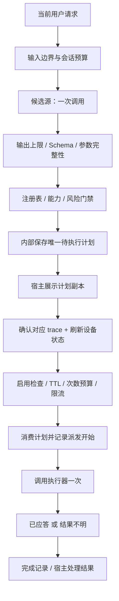
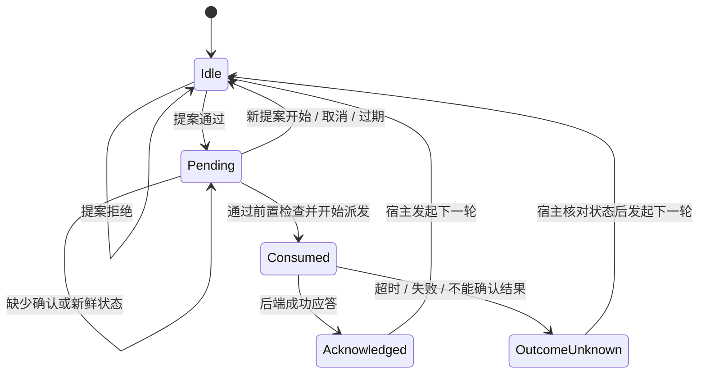

# 受限设备上的 Agent 参考范式

EdgeHome 的目标是提供一个可以读懂、运行和替换组件的工程范式：让小模型提出动作，由宿主程序限定资源、校验动作，并决定何时执行。智能家居是目前的具体领域；其他受限场景可以复用这一分工，再替换领域类型、能力规则和设备适配器。

`edgehome-agent` 是这一范式的可嵌入 Rust 实现。它复用现有的 parser、output governor、registry、gate、planner、executor 和 trace。原有 CLI 保留记忆、规则修复、回放、评测与后端配置工作流；新运行时展示的是一个更小、边界明确的单动作会话。

## 先运行，再阅读

在仓库根目录执行，不需要下载模型、配置凭据或连接硬件：

```sh
cargo run --locked -p edgehome-agent --example bounded_agent
cargo run --locked -p edgehome-agent --example bounded_agent -- --execute-mock
```

第一条展示灯光计划、危险设备拒绝、时间条件拒绝。第二条额外演示宿主明确确认后的模拟执行，以及同一计划重放被拒绝。示例使用规则候选源、MockExecutor 和内存 SQLite，退出即释放记录；它验证流程，不衡量模型能力。

实现入口：[运行时](../crates/edgehome-agent/src/lib.rs) · [可运行示例](../crates/edgehome-agent/examples/bounded_agent.rs) · [边界测试](../crates/edgehome-agent/src/tests.rs)。

## 四个角色，三个边界

| 角色 | 拥有的权限 | 交给下游的内容 |
| --- | --- | --- |
| 候选源 `CandidateProvider` | 根据当前输入提出一个候选 | 后端无关 JSON，始终视为不可信 |
| 运行时 `AgentRuntime` | 限定预算，校验、解析设备、调用门禁，保管待执行计划 | 可展示的计划副本与 trace ID |
| 宿主应用 | 管理用户身份、取得确认、读取设备状态、配置资源预算 | 对特定 trace 的确认与状态新鲜度 |
| 设备执行器 `Executor` | 根据已配置路由调用设备协议 | 调用是否被接受；不能据此推断物理动作已完成 |

模型无法修改预算、确认动作、选择凭据或直接调用执行器。宿主及适配器是受信任代码；这不是防御恶意本地 Rust 代码的进程沙箱。



## 状态与失败语义

一个实例代表一个宿主管理的会话，最多保存一个待执行计划。每次新提案，包括失败提案，都会撤销旧计划，避免用户改变请求后仍能执行旧动作。实例不自动读取数据库历史，也不自动补齐“刚才那个”的设备指代。



`execute` 仅接收 trace ID、宿主确认和状态新鲜度。它不接收客户端传来的 `DryRunPlan`。修改预览中的动作或设备，不会修改运行时内部的计划。别的实例、已消费或过期的 trace 也不能用来执行。

所有动作都要求宿主确认，包括低风险灯光。宿主必须把真实用户身份与对应预览绑定；`host_confirmed: true` 是受信任代码给出的断言，不是认证机制。`StateFreshness` 同样必须来自宿主观测，不是模型推测。

执行器返回错误时可能已经操作了设备，因此运行时返回 `OutcomeUnknown`，消费该计划，不自动重试。宿主应先读回状态，再决定是否创建新请求。这里提供的是**单个运行时内每个计划最多尝试派发一次**，不是跨进程或设备端的 exactly-once。

派发前必须写入开始记录；存储失败时不调用后端。派发后的完成记录如果失败，返回 `completion_recorded: false`，计划仍不可重放。修复审计记录不能成为再次操作设备的理由。

## 资源预算

| 配置 | 默认值 | 约束对象 |
| --- | ---: | --- |
| `max_proposals` | 16 | 一个实例的提案总次数，失败请求也计入 |
| `max_execution_attempts` | 4 | 一个实例的执行尝试次数 |
| `max_input_chars` | 500 | 当前输入及保留输入的字符数 |
| `model_budget.max_output_bytes` | 4096 | 候选源返回的 JSON 字节数 |
| `model_budget.timeout` | 8 秒 | 候选源必须遵守的传输总时限 |
| `plan_ttl` | 30 秒 | 待执行计划的有效期，使用单调时钟 |
| `execute_enabled` | false | 宿主是否允许进入执行路径 |

不做无限循环、隐式模型重试或自动执行重试。次数预算耗尽后，由宿主显式开启新会话。`ExecutionTransaction` 在实例内持续存在，其设备/动作冷却状态不会每轮重建。

有 trace 的计划以 trace ID 作为幂等身份；新一轮独立确认的“开灯”可以在冷却后再次执行，不会被永久当作第一次“开灯”的重复。向执行器派发时，计划副本的 `dry_run` 设为 false；展示给宿主的原始 dry-run 预览保持不变。

同步 Rust 回调无法被强制中断。候选源必须在网络接收阶段限制响应字节数，并落实连接和总时限；运行时只会在回调返回后拒绝超时或超大结果。这里的预算不等于整个进程、模型权重、KV cache 或数据库磁盘的硬内存上限。长期 trace 保留、进程 watchdog 和系统资源配额由部署层管理。

## 接入自己的模型与设备

1. **候选源。** 实现 `CandidateProvider::propose`。把当前 `UserInput` 转成候选 JSON；在本地模型 HTTP/IPC 适配器中消费 `ModelBudget`，不要把后端路由或凭据送入 prompt。生产接入不能照搬示例的规则源来宣称真实模型效果。
2. **设备注册表。** 配置设备别名、类型、能力范围、风险与后端路由。候选中的设备标识只能用于解析，最终 ID 来自注册表。未知别名拒绝，不悄悄替换成另一台设备。
3. **执行器。** 复用 Home Assistant、MQTT 或 bridge 执行器，或者实现 `Executor`。执行器需要自己的协议超时、凭据管理和结果处理；如果新增 backend kind，还要提供 planner 使用的载荷适配器。
4. **宿主。** 保持运行时实例存活，展示 `Proposal::Ready`，确认同一 trace，刷新状态，再调用 `execute`。用户取消时调用 `cancel_pending`。持续运行时使用文件 SQLite，并制定保留策略。
5. **领域迁移。** 当前 `Intent`、`DeviceType` 和 `Action` 是智能家居枚举。迁移到其他领域需要扩展这些类型、schema、registry、policy 和 adapter；当前版本不是任意工具调用框架。

参考示例中的 synthetic `Fresh` 和自动传入 `true` 仅用于用户显式开启的模拟执行演示，不可代替真实宿主的观测、鉴权和确认 UI。

## 与现有 CLI 的关系

| 路径 | 适合用途 | 主要区别 |
| --- | --- | --- |
| 原有 `edgehome` CLI | 回归评测、记忆演示、Ollama 与后端调试、历史 trace 检查 | 保留已有 108 条 mock 基线与规则修复行为 |
| 新 `AgentRuntime` | 嵌入本地应用，学习并迁移受限执行范式 | 实例内预算与计划，必须明确目标，不隐式修复模型候选 |

新运行时复用底层组件，但没有把旧 CLI 全部迁移到新 API。因此旧 CLI 的跨进程限流、全库短记忆等限制仍存在，不能把新运行时的保证套用到旧 CLI 上。两条路径共用的 `ExecutionTransaction` 现在会拒绝带 `time_after` 的实际派发；dry-run 和现有槽位评测仍可展示时间条件。

## 验收与可证明的边界

```sh
cargo test --locked -p edgehome-agent -p edgehome-executor
cargo run --locked -p edgehome-agent --example bounded_agent -- --execute-mock
```

测试使用带调用计数的执行器和故障注入，验证默认不执行、确认/新鲜度要求、预览篡改隔离、实例隔离、过期、撤销、预算、跨轮冷却、危险动作拒绝、模型错误、参数缺失、派发前存储失败和派发后存储失败。测试检查后端是否真正被调用，而不只检查返回值。

这是使用 Rust `std` 和 SQLite 的本地进程参考实现，适用于考虑 Linux 级边缘设备的应用设计。它不宣称支持裸机 MCU、`no_std`、硬实时调度、完整自主规划、多设备事务、跨进程持久化调度或实体设备的最终一致性保证。下一步应先给一个真实模型适配器和一台真实设备补独立证据，再扩大能力范围。
