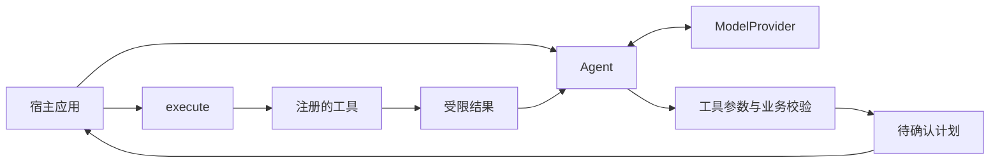

# 端侧 Agent SDK

EdgeHome 提供一个面向本地小模型的 Rust Agent 开发基座。应用注册自己的工具、选择推理服务、管理确认流程；运行时负责限制调用次数、校验候选、保存待执行计划、回传工具结果和记录事件。

设计参考 Pi 的统一模型接口、工具扩展和可嵌入运行时，实现在本仓库中独立维护，不依赖 Pi，也不声明兼容其扩展包。端侧版本首先支持短任务、少量工具和显式确认的循环。[Pi 项目](https://github.com/earendil-works/pi)

## 模块与依赖

需要多轮补充信息时，使用 `clarification()` 取得任务内的澄清 ID，调用
`reply(id, text)` 保留上下文继续询问模型，或 `resolve(id, values)` 直接填充宿主确认的字段。
后者保留其他草案参数、重新做类型和业务校验，不额外请求模型；两者均不执行工具。
`Tool::preflight` / `GuardedTool` 支持允许、澄清、拒绝三种结果，并在执行前再次检查。
完整接口、RPC 协议、边界及真实应用见[文件 Agent](file-agent.md)。

| 模块 | 职责 | 依赖边界 |
| --- | --- | --- |
| `edgehome-runtime` | `Agent`、类型化工具、上下文预算、计划、事件 | 不依赖家居枚举、HTTP、SQLite 或推理引擎 |
| `edgehome-inference` | `HttpProvider`、引擎配置、受限 HTTP 传输 | 原生 Ollama 与 OpenAI-compatible 两种协议 |
| `edgehome-kit` | 项目模板、doctor/run/rpc/eval、事件日志 | 应用入口；具体业务工具留在生成项目中 |
| 应用工具 | 文件、设备、服务或业务系统的实际操作 | 应用实现参数约束、权限、状态检查和 I/O 时限 |
| 原有 `edgehome-agent` 与 CLI | 智能家居参考实现和已有评测 | 保留原设备注册表、门禁、SQLite、记忆和规则修复链路 |

新项目优先使用 `edgehome_runtime::Agent`。原有 `edgehome_agent::AgentRuntime` 的保障和评测不能直接套用到新 SDK，反之亦然。当前通用工具注册不自动导入旧设备适配器；需要家居功能时可继续使用原参考实现，或显式包装为业务工具。

## 快速运行

希望直接创建独立应用时，优先使用[开发工具指南](developer-kit.md)中的 `init`。以下是仓库内最小示例，适合阅读 SDK 接口。

在仓库根目录运行，不需要模型或设备：

```sh
cargo run --locked -p edgehome-inference --example document_agent
cargo run --locked -p edgehome-inference --example document_agent -- --execute-demo
```

第一条只输出工具计划。第二条允许示例读取内置文档，返回 84 个字符、2 行，再把结果交回确定性候选源生成最终回答。示例不读取用户文件，不访问设备；这条路径证明 SDK 工作流，不衡量模型能力。

连接已运行的推理引擎：复制 `configs/inference/` 中对应的配置，将 `model` 改成服务实际暴露的名称，然后执行：

```sh
cargo run --locked -p edgehome-inference --example document_agent -- --config configs/inference/ollama.yaml --execute-demo
```

`--execute-demo` 只授权这个示例中的只读文档工具，示例最多执行一次工具。真实业务必须自行取得与计划 ID 绑定的确认。`--trace-model` 会把请求（含提示、工具结果、响应 Schema）和模型原始候选输出到 stderr，用于定位接入问题；默认关闭，输出可能包含业务数据。

推理引擎安装、模型下载和硬件选择见[推理引擎接入](inference-engines.md)。这些操作不由 SDK 自动执行。

对于只需要结构化结果的任务，可增加 `--result-only`：模型只选择工具，宿主展示执行回执，不再让模型改写结果。应用代码对应在 `execute` 后直接消费 `receipt.output`，不调用 `continue_run`。这可以省掉一次推理，并避免最终回答的转述错误；首轮工具选择和参数仍需验证。

## 在自己的项目中集成

1. **引入库。** 在自己的 Cargo 项目使用指向本仓库 `crates/edgehome-runtime` 和 `crates/edgehome-inference` 的路径依赖。这份仓库提供源码集成，不要求先发布 crates.io 包。
2. **定义工具。** 参数结构派生 `Deserialize` 与 `JsonSchema`，使用 `#[serde(deny_unknown_fields)]`，通过 `TypedTool::new` 注册名称、简短描述、校验函数和执行函数。为小模型提供具体参数示例会比宽泛描述更容易调试。
3. **配置模型。** 创建 `HttpProvider::new(InferenceConfig)`。内置引擎不需要重复实现 HTTP、超时或响应大小限制；自定义推理方式实现 `ModelProvider`。
4. **驱动循环。** `prompt` 返回工具计划、最终回答或澄清。宿主展示计划并确认后调用 `execute`；只有 `continuation_available` 为 true 时再调用 `continue_run`。

完整、可编译的接入实例是 [document_agent.rs](../crates/edgehome-inference/examples/document_agent.rs)。把 `document.stats` 替换为文档解析、传感器读取或服务操作，无需修改运行时里的领域枚举。

例如，应用项目与本仓库并列时，可使用以下依赖配置；按实际目录调整 `path`：

```toml
[dependencies]
edgehome-runtime = { path = "../EdgeHome-Harness/crates/edgehome-runtime" }
edgehome-inference = { path = "../EdgeHome-Harness/crates/edgehome-inference" }
serde = { version = "1", features = ["derive"] }
serde_json = "1"
schemars = { version = "0.8", features = ["derive"] }
```



工具描述与 Schema 由可信宿主注册。运行时把每个工具的参数 Schema 合入候选响应 Schema，`TypedTool` 再通过同一个 Rust 参数类型反序列化并执行校验函数。Schema 的约束生成能力取决于推理后端；类型检查和业务检查始终在宿主再次执行。

`JsonSchema` 的描述性约束不会自动变成业务权限。例如金额上限、文件目录、设备范围、用户权限和状态版本，都必须在校验函数中落实。该函数应无副作用，提案时和派发前都会调用。真实路径、凭据和内部连接保留在处理函数闭包或宿主服务里。

## 循环、确认与结果

宿主可使用 `prompt_with_tools` 选择当前任务可见的工具；Schema 和本地调用检查同时应用该范围。普通 `prompt` 暴露全部注册工具。筛选不会提升模型理解能力，但可以缩小选择空间、减少无关描述和 Schema。

默认候选协议有三个分支：`call` 包含工具名称与参数；`final` 包含回答；`clarify` 包含澄清问题。可显式选择 `DecisionProtocol::Action`，先生成 `action` 再生成参数，并支持用 null 表示明确非空的必填参数缺失；宿主随后返回澄清，工具类型不放宽。该协议保留 `clarify`、`final` 两个动作名称，不可用于业务工具名称。每轮最多一个调用，运行时不自动批准或调用工具。

`max_decision_repairs` 默认为 0，可设置为 1 或 2，仅对无效决策、参数校验错误及缺少必需工具观察的最终回答增加有预算的纠错。每次都计入实例模型预算并记录 `ValidationRepair`；策略拒绝、传输错误和工具执行不重试。有效但选错的动作仍需应用识别。协议与模型实测见[可靠性指南](model-reliability.md)。

`require_tool_observation: true` 可以要求当前任务先取得成功工具结果，才接受最终回答。这个限制同时体现在模型响应 Schema 和宿主校验中；澄清始终可用。它不能证明最终回答忠实于工具结果，也不能替代应用级事实核验。

执行预算耗尽后，下一轮 Schema 移除 `call` 分支，仍允许生成回答或澄清。即使后端不遵守 Schema，运行时仍拒绝额外调用。实例的模型和工具总次数不会因新 `prompt` 而重置。

待执行计划仅由实例内部保存，预览是副本。新 `prompt`、取消、过期都会使旧计划失效。`execute` 接收计划 ID 和宿主确认，不接收可被客户端改写的计划。确认是宿主断言，不是用户认证机制。

派发前必须成功记录事件；失败时不调用工具。派发后遇到处理器错误、超时或超大结果，返回 `OutcomeUnknown`，不允许自动继续，不恢复已消费计划，也不自动重试。完成事件写入失败通过 `completion_recorded: false` 报告；宿主应处理记录和状态，不重新执行来修复日志。

## 默认预算

| 配置 | 默认值 |
| --- | ---: |
| 模型调用次数 / 工具派发次数 | 8 / 4，按实例累计 |
| 已注册工具数量 | 最多 8 |
| 用户输入 / 模型候选 / 工具结果 | 2,048 / 4,096 / 4,096 字节 |
| 序列化消息与响应 Schema 的总预算 | 16,384 字节 |
| 模型调用 / 工具调用时限 | 15 / 10 秒 |
| 计划有效期 | 30 秒，单调时钟 |
| 真实派发 | 默认关闭 |
| 内存事件保留 | 默认最近 128 条元数据 |

上下文超限会明确停止，不静默丢弃系统约束或截断工具结果。`prompt` 开始新任务时清空对话上下文；同一任务内保留模型调用与已接受的工具结果。

默认 `MemoryJournal` 是有界内存记录，不提供持久审计。应用可实现 `Journal` 接入文件、数据库或现有日志系统。事件默认不保存原始输入、参数或模型文本；需要保留时由应用实现脱敏和保留策略。

`ObservedJournal` 在底层日志接受事件后调用宿主监听器；监听器应保持快速。运行时增加任务与模型开始/结束事件，`usage()` 提供预算使用和计划状态。`cancellation_token()` 返回可在线程间共享的一次性取消信号；自定义 provider 可覆盖 `complete_cancellable`，工具通过 `ToolContext.cancellation` 检查它。取消后创建新实例，不能复活已消费的计划。

## 工程边界

- 工具、模型客户端和日志接收器都是可信的同步 Rust 代码。运行时无法强制中断任意回调，也无法限制其内部内存分配；自定义工具必须遵守 `ToolContext` 并落实传输超时。内置 HTTP 模型客户端在传输阶段执行限额。
- 字节预算不等于 token 预算或整个进程的内存配额。推理权重、KV cache、模型冷启动与系统资源隔离由部署负责。
- 工具结果作为数据进入模型上下文。提示和预算不能保证模型不会受提示注入影响；工具白名单、业务校验和确认是独立约束。
- 当前提供 Rust SDK、独立应用模板和顺序 stdio RPC，包含 Python 客户端示例；网络服务、专用语言 SDK、技能包加载、沙箱、跨进程恢复和 UI 尚未实现。
- 这是参考 SDK，不是 Pi 的移植，也不声明成熟的无人值守执行或真机长稳能力。

验证：`cargo test --locked -p edgehome-runtime -p edgehome-inference`。测试覆盖真实调用计数、故障日志、计划隔离、参数与权限拒绝、循环预算、结构化协议和本地 HTTP 传输限额。
